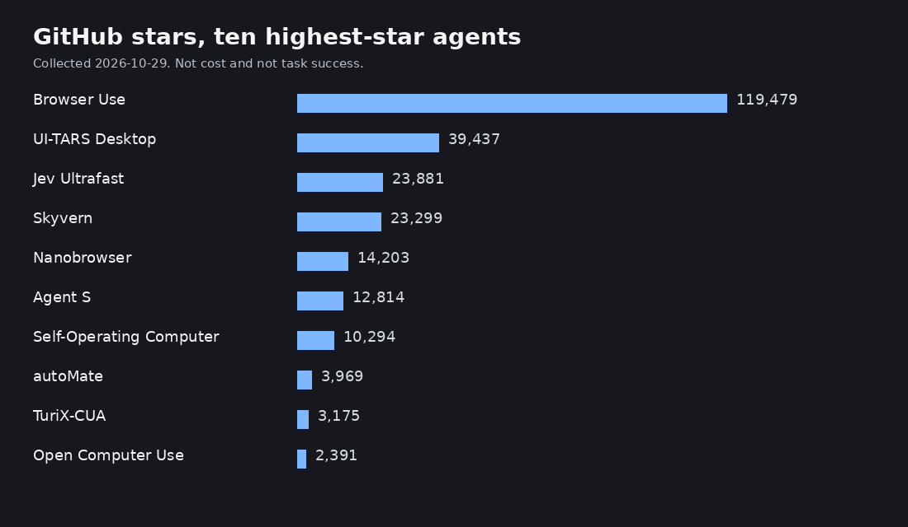

# Awesome Computer Use

Computer-use agents operate software the way a person does: they look at a browser or a desktop, then click, type, and scroll. This is a dated catalog of the agents, harnesses, models, benchmarks, and tools behind that loop. Every star count and last-commit date was read from the GitHub API. A project is marked checked only when this repository installed it or ran it, and the log says which.

**43 listed · 3 checked in this repo · 0 tested on the shared task · GitHub facts collected 2026-10-29.**

No shared-task cost was measured. There is no cost-by-success chart because that would be invented. The bars below are GitHub stars for the ten highest-star agents whose star count belongs to that repository.



```text
Browser Use              119,479  ████████████████████████
UI-TARS Desktop           39,437  ████████
Jev Ultrafast             23,881  █████
Skyvern                   23,299  █████
Nanobrowser               14,203  ███
Agent S                   12,814  ███
Self-Operating Computer   10,294  ██
autoMate                   3,969  █
TuriX-CUA                  3,175  █
Open Computer Use          2,391  █
```

## Ten highest-star agents

| Agent | Interface | Runs locally | License | Stars | Last commit | Checked here |
| --- | --- | --- | --- | ---: | --- | --- |
| [Browser Use](#browser-use) | browser | partial | MIT | 119,479 | 2026-10-26 | — |
| [UI-TARS Desktop](#ui-tars-desktop) | desktop, browser | partial | Apache-2.0 | 39,437 | 2026-10-09 | — |
| [Jev Ultrafast](#jev-ultrafast) | browser | partial | MIT | 23,881 | 2026-09-18 | — |
| [Skyvern](#skyvern) | browser | partial | AGPL-3.0 | 23,299 | 2026-10-29 | — |
| [Nanobrowser](#nanobrowser) | browser | yes | Apache-2.0 | 14,203 | 2026-10-24 | — |
| [Agent S](#agent-s) | Linux desktop, macOS desktop, Windows desktop, browser | partial | Apache-2.0 | 12,814 | 2026-10-21 | — |
| [Self-Operating Computer](#self-operating-computer) | desktop | partial | MIT | 10,294 | 2026-10-19 | — |
| [autoMate](#automate) | browser, desktop | yes | MIT | 3,969 | 2026-09-17 | — |
| [TuriX-CUA](#turix-cua) | desktop | partial | MIT | 3,175 | 2026-09-14 | — |
| [Open Computer Use](#open-computer-use) | Linux desktop | no | Apache-2.0 | 2,391 | 2026-10-23 | — |

The Anthropic desktop demo is listed under Agents, but it is not in this table: its star count belongs to `anthropics/claude-quickstarts`, which also holds unrelated demos.

The full catalog is 16 agents, 11 harnesses, 1 model, 6 benchmarks, 9 tools. [Open `docs/compare.html`](docs/compare.html) in a browser and click a column heading to sort every entry. GitHub's own file view does not run that script.

## Agents

### Browser Use

Python library that lets an LLM operate a real browser: the model picks the next click, keystroke, or navigation, and the library carries it out. The same maintainers sell cloud browsers beside the open-source package.

| | |
| --- | --- |
| Repository | [browser-use/browser-use](https://github.com/browser-use/browser-use) |
| Authors | Browser Use (GitHub organization) |
| Interface | browser |
| Models | An LLM configured by the caller. The README also documents a local model through Ollama. |
| Runs locally | partial. The MIT library can drive a browser on your machine. Hosted browsers and a hosted agent are a separate paid product. |
| License | MIT |
| Stars | 119,479 |
| Last commit | 2026-10-26 (`2cc71890e6`) |
| Shared task | Not tested yet. Listed 2026-10-29. |
| Checked here | — |

Sources: <https://github.com/browser-use/browser-use>.

### UI-TARS Desktop

ByteDance's multimodal agent stack. The same repository ships Agent TARS, which brings GUI actions into a terminal workflow, and UI-TARS Desktop, a native app with operators for a local computer, a remote computer, and a browser. The README is in English and links a Chinese translation.

| | |
| --- | --- |
| Repository | [bytedance/UI-TARS-desktop](https://github.com/bytedance/UI-TARS-desktop) |
| Authors | ByteDance (GitHub organization bytedance) |
| Interface | desktop, browser |
| Models | The UI-TARS vision-language model, plus other multimodal models the Agent TARS stack can call. |
| Runs locally | partial. UI-TARS Desktop ships local and remote computer operators. Agent TARS also runs as a CLI. Model weights are separate from the app. |
| License | Apache-2.0 |
| Stars | 39,437 |
| Last commit | 2026-10-09 (`3ac2cb8d94`) |
| Shared task | Not tested yet. Listed 2026-10-29. |
| Checked here | — |

Sources: <https://github.com/bytedance/UI-TARS-desktop>.

### Jev Ultrafast

Browser agent from the Browser Use project. Each observation is an indexed list of elements; a decision model picks an operation and a target, and a smaller model supplies text only for typing steps.

| | |
| --- | --- |
| Repository | [browser-use/jev-ultrafast](https://github.com/browser-use/jev-ultrafast) |
| Authors | Browser Use (GitHub organization) |
| Interface | browser |
| Models | A decision model chooses an operation and an element. A smaller model writes text only when the operation is typing. |
| Runs locally | partial. The code is open source. The README points at a Browser Use Cloud waitlist for the hosted version. |
| License | MIT |
| Stars | 23,881 |
| Last commit | 2026-09-18 (`1231850a0b`) |
| Shared task | Not tested yet. Listed 2026-10-29. |
| Checked here | — |

Sources: <https://github.com/browser-use/jev-ultrafast>.

### Skyvern

Python system for browser workflows. It uses a language model together with computer vision so the steps follow what is on the page instead of a fixed selector script. Licensed AGPL-3.0.

| | |
| --- | --- |
| Repository | [Skyvern-AI/skyvern](https://github.com/Skyvern-AI/skyvern) |
| Authors | Skyvern (GitHub organization Skyvern-AI) |
| Interface | browser |
| Models | LLMs you connect. The README presents the system as LLM plus computer vision rather than a single bundled model. |
| Runs locally | partial. The application is open source and can be self-hosted. Skyvern also offers a hosted product at skyvern.com. |
| License | AGPL-3.0 |
| Stars | 23,299 |
| Last commit | 2026-10-29 (`967fd75ba2`) |
| Shared task | Not tested yet. Listed 2026-10-29. |
| Checked here | — |

Sources: <https://github.com/Skyvern-AI/skyvern>.

### Anthropic Computer Use Demo

Reference desktop agent from Anthropic: a Dockerized Linux desktop controlled through Claude's computer-use tools, with a Streamlit UI. It lives in the claude-quickstarts repository, which also contains unrelated demos.

| | |
| --- | --- |
| Repository | [anthropics/claude-quickstarts](https://github.com/anthropics/claude-quickstarts/tree/main/computer-use-demo) |
| Authors | Anthropic (GitHub organization anthropics) |
| Interface | Linux desktop |
| Models | Claude models through the Anthropic API, Bedrock, or Vertex. The demo README names Opus 4.8 as the default at the time it was read. |
| Runs locally | partial. The reference loop runs in a Docker container with a Linux desktop (X11 and VNC) on a machine you control. Model calls go to Anthropic, Bedrock, or Vertex. |
| License | MIT |
| Stars | 19,048 |
| Last commit | 2026-10-29 (`12349bb27f`) |
| Shared task | Not tested yet. Listed 2026-10-29. |
| Checked here | — |
| Scope | Stars are for `anthropics/claude-quickstarts`, which contains other projects. The commit above is the latest on `computer-use-demo` (`1a18c340ca` on the default branch is 2026-10-29). |

Sources: <https://github.com/anthropics/claude-quickstarts/tree/main/computer-use-demo>.

### Nanobrowser

Chrome extension that runs an agent inside the browser profile you already use, so it can see sites where that profile is logged in. Automation stays in the browser; it is not a desktop mouse driver.

| | |
| --- | --- |
| Repository | [nanobrowser/nanobrowser](https://github.com/nanobrowser/nanobrowser) |
| Authors | Nanobrowser (GitHub organization) |
| Interface | browser |
| Models | Whatever model key you put in the extension. The project does not ship a model. |
| Runs locally | yes |
| License | Apache-2.0 |
| Stars | 14,203 |
| Last commit | 2026-10-24 (`19dc8e8a9b`) |
| Shared task | Not tested yet. Listed 2026-10-29. |
| Checked here | — |

Sources: <https://github.com/nanobrowser/nanobrowser>.

### Agent S

Simular's GUI agent for desktop and web apps on macOS, Windows, and Linux. A written task goes in; pointer and keyboard actions come out. The repository also links a hosted Simular API, which this list did not call.

| | |
| --- | --- |
| Repository | [simular-ai/Agent-S](https://github.com/simular-ai/Agent-S) |
| Authors | Simular (GitHub organization simular-ai) |
| Interface | Linux desktop, macOS desktop, Windows desktop, browser |
| Models | Whichever multimodal model the framework is pointed at. The README also links a hosted Simular API. |
| Runs locally | partial. The framework runs on a machine you control. Simular additionally sells a hosted computer API. |
| License | Apache-2.0 |
| Stars | 12,814 |
| Last commit | 2026-10-21 (`0fff0e6348`) |
| Shared task | Not tested yet. Listed 2026-10-29. |
| Checked here | — |

Sources: <https://github.com/simular-ai/Agent-S>.

### Self-Operating Computer

Python framework from OthersideAI that shows a multimodal model the screen and applies the mouse and keyboard actions it returns. The README dates the first release to November 2023; the default branch was still moving in October 2026.

| | |
| --- | --- |
| Repository | [OthersideAI/self-operating-computer](https://github.com/OthersideAI/self-operating-computer) |
| Authors | OthersideAI (GitHub organization) |
| Interface | desktop |
| Models | The README lists integrations including GPT-4o, GPT-4.1, o1, Gemini, Claude 3, Qwen-VL, and LLaVA. Those are options, not models this list ran. |
| Runs locally | partial. The framework runs on the computer it controls. The model is usually a remote multimodal API. |
| License | MIT |
| Stars | 10,294 |
| Last commit | 2026-10-19 (`eb8165a2ef`) |
| Shared task | Not tested yet. Listed 2026-10-29. |
| Checked here | — |

Sources: <https://github.com/OthersideAI/self-operating-computer>.

### autoMate

Local assistant that keeps notes and files on the machine where it is installed and exposes them over MCP and HTTP. The current README includes shell, browser, and desktop actions, plus control of the user's Chrome through an extension.

| | |
| --- | --- |
| Repository | [yuruotong1/autoMate](https://github.com/yuruotong1/autoMate) |
| Authors | yuruotong1 (GitHub user) |
| Interface | browser, desktop |
| Models | The README shows it sitting behind several chat clients (Claude Desktop, Cursor, Cline, and others) rather than one bundled model. |
| Runs locally | yes |
| License | MIT |
| Stars | 3,969 |
| Last commit | 2026-09-17 (`afb89b9d67`) |
| Shared task | Not tested yet. Listed 2026-10-29. |
| Checked here | — |

Sources: <https://github.com/yuruotong1/autoMate>.

### TuriX-CUA

Desktop computer-use agent from TurixAI. It takes actions on the machine it is installed on, and the README says the model is selected in config.json. The README is English and links a Chinese translation. This list did not reproduce the benchmark figures printed there.

| | |
| --- | --- |
| Repository | [TurixAI/TuriX-CUA](https://github.com/TurixAI/TuriX-CUA) |
| Authors | TurixAI (GitHub organization) |
| Interface | desktop |
| Models | Whichever model you set in config.json. The README tells you to change that file rather than bundling one model. |
| Runs locally | partial. The agent code is meant to run on your computer. The model endpoint is your own configuration, so inference may be remote. |
| License | MIT |
| Stars | 3,175 |
| Last commit | 2026-09-14 (`88c777bddf`) |
| Shared task | Not tested yet. Listed 2026-10-29. |
| Checked here | — |

Sources: <https://github.com/TurixAI/TuriX-CUA>.

### Open Computer Use

Agent that controls a cloud Linux desktop with the keyboard, the mouse, and the shell. The desktop is an E2B sandbox, and the README says the model can be an open-source LLM. The client can stream that display.

| | |
| --- | --- |
| Repository | [e2b-dev/open-computer-use](https://github.com/e2b-dev/open-computer-use) |
| Authors | E2B (GitHub organization e2b-dev) |
| Interface | Linux desktop |
| Models | Open-source LLMs, plus OS-Atlas, ShowUI, and other models the README says can be plugged in. |
| Runs locally | no. The agent code is open source, but the desktop it controls is an E2B cloud sandbox, not the machine where you cloned the repo. |
| License | Apache-2.0 |
| Stars | 2,391 |
| Last commit | 2026-10-23 (`ee1025911c`) |
| Shared task | Not tested yet. Listed 2026-10-29. |
| Checked here | — |

Sources: <https://github.com/e2b-dev/open-computer-use>.

### Surf

Web app that connects OpenAI's computer-use API to an E2B virtual desktop. You type a task, and the agent acts on that remote desktop while the page shows the session.

| | |
| --- | --- |
| Repository | [e2b-dev/surf](https://github.com/e2b-dev/surf) |
| Authors | E2B (GitHub organization e2b-dev) |
| Interface | desktop |
| Models | OpenAI's computer-use API, as stated in the repository README. |
| Runs locally | partial. The Next.js app can be run from the repository. The desktop it drives is an E2B cloud sandbox and the model is OpenAI's. |
| License | Apache-2.0 |
| Stars | 873 |
| Last commit | 2026-10-13 (`d66db293ac`) |
| Shared task | Not tested yet. Listed 2026-10-29. |
| Checked here | — |

Sources: <https://github.com/e2b-dev/surf>.

### AutoCua

Python harness that drives macOS, Windows, Linux, and a browser, and the README also claims phone control. Desktop actions are described as real hardware events. The browser side is described as Rust plus a Chrome extension.

| | |
| --- | --- |
| Repository | [ComputerUseAgent/AutoCua](https://github.com/ComputerUseAgent/AutoCua) |
| Authors | ComputerUseAgent (GitHub organization) |
| Interface | Linux desktop, macOS desktop, Windows desktop, browser |
| Models | The README says the project can call many models across several providers. No single model is bundled in the description used here. |
| Runs locally | partial. Desktop input is described as happening on the machine. Model calls depend on the provider you configure. Phone control is also claimed in the README. |
| License | MIT |
| Stars | 807 |
| Last commit | 2026-10-28 (`0b4a9f368f`) |
| Shared task | Not tested yet. Listed 2026-10-29. |
| Checked here | — |

Sources: <https://github.com/ComputerUseAgent/AutoCua>.

### OpenGCUA

Open stack from Tongyi-MAI for a generalist computer-use agent that can mix GUI actions with code execution. The release includes prompts and evaluation trajectories. The paper is arXiv:2610.22200.

| | |
| --- | --- |
| Repository | [Tongyi-MAI/OpenGCUA](https://github.com/Tongyi-MAI/OpenGCUA) |
| Authors | Hanzhang Zhou, Long Li, Quyu Kong, and co-authors. Repository published by Tongyi-MAI. |
| Interface | macOS desktop, browser, desktop |
| Models | The technical report evaluates several external models. This list did not re-run those evaluations. |
| Runs locally | partial. The repository includes a macOS harness and prompts. The paper also describes a cross-device SDK. This list did not install the harness. |
| License | Apache-2.0 |
| Stars | 548 |
| Last commit | 2026-10-26 (`55c33aea79`) |
| Shared task | Not tested yet. Listed 2026-10-29. |
| Checked here | — |

Sources: <https://github.com/Tongyi-MAI/OpenGCUA>, <https://arxiv.org/abs/2610.22200>.

### Browser Use Pi

Small TypeScript browser agent. It keeps a JavaScript REPL, drives Chrome over the DevTools Protocol, and reads the accessibility tree plus screenshots. The published quick start expects an OpenRouter key and a Browser Use key.

| | |
| --- | --- |
| Repository | [browser-use/browser-use-pi](https://github.com/browser-use/browser-use-pi) |
| Authors | Browser Use (GitHub organization) |
| Interface | browser |
| Models | The README's start snippet sets OPENROUTER_API_KEY and BROWSER_USE_API_KEY. |
| Runs locally | partial. The TypeScript SDK runs in your process and talks to Chrome, and the documented setup uses hosted model and browser keys. |
| License | MIT |
| Stars | 437 |
| Last commit | 2026-10-20 (`5569fba817`) |
| Shared task | Not tested yet. Listed 2026-10-29. |
| Checked here | — |

Sources: <https://github.com/browser-use/browser-use-pi>.

### DeskMind

macOS computer-use app that reads the screen, picks the next step, and acts with small models running on that Mac. The README says it asks the user when a step is ambiguous instead of guessing.

| | |
| --- | --- |
| Repository | [deskmind-ai/deskmind](https://github.com/deskmind-ai/deskmind) |
| Authors | DeskMind (GitHub organization deskmind-ai) |
| Interface | macOS desktop |
| Models | Small on-device MLX models published by the project. The README says they run on the Mac. |
| Runs locally | yes |
| License | Apache-2.0 |
| Stars | 125 |
| Last commit | 2026-10-26 (`ac985d222e`) |
| Shared task | Not tested yet. Listed 2026-10-29. |
| Checked here | — |

Sources: <https://github.com/deskmind-ai/deskmind>.

## Harnesses

### Cua

Open-source computer-use stack: desktop drivers, local virtual machines, decision models, and a benchmark. The README also points at Cua Spaces, which gives an agent a full desktop.

| | |
| --- | --- |
| Repository | [trycua/cua](https://github.com/trycua/cua) |
| Authors | trycua (GitHub organization) |
| Interface | Linux desktop, macOS desktop, Windows desktop |
| Models | The README describes CUA-S1 decision models in this repository, and the stack can also call external models. |
| Runs locally | partial. Lume runs local VMs on a Mac, and the README also describes Cua Spaces desktops on machines you own. A hosted product sits beside the open-source stack. |
| License | MIT |
| Stars | 31,293 |
| Last commit | 2026-10-29 (`b269d38db5`) |
| Shared task | Not tested yet. Listed 2026-10-29. |
| Checked here | — |

Sources: <https://github.com/trycua/cua>.

### Stagehand

SDK for browser agents from Browserbase. You mix ordinary browser commands with natural-language steps, and the same API can target a browser on your machine or a Browserbase session.

| | |
| --- | --- |
| Repository | [browserbase/stagehand](https://github.com/browserbase/stagehand) |
| Authors | Browserbase (GitHub organization browserbase) |
| Interface | browser |
| Models | The SDK is called with a model you choose. Browserbase documents computer-use modes for several providers; this list did not execute them. |
| Runs locally | partial. Stagehand can drive a local browser or Browserbase's hosted browsers. |
| License | MIT |
| Stars | 25,858 |
| Last commit | 2026-10-29 (`44d99dfbdd`) |
| Shared task | Not tested yet. Listed 2026-10-29. |
| Checked here | — |

Sources: <https://github.com/browserbase/stagehand>.

### Browser Harness

Harness that lets a coding agent drive the Chrome already running on your machine, including pages where you are logged in, over the DevTools Protocol. The agent can add helper code as a task needs it.

| | |
| --- | --- |
| Repository | [browser-use/browser-harness](https://github.com/browser-use/browser-harness) |
| Authors | Browser Use (GitHub organization) |
| Interface | browser |
| Models | None of its own. A coding agent you already run (the README names Claude Code, Codex, and Cursor) decides what to do. |
| Runs locally | yes |
| License | MIT |
| Stars | 18,701 |
| Last commit | 2026-10-25 (`4ced8e0087`) |
| Shared task | Not tested yet. Listed 2026-10-29. |
| Checked here | — |

Sources: <https://github.com/browser-use/browser-harness>.

### Midscene

JavaScript test framework that uses a vision model to drive interfaces written as natural-language steps. The README covers web, mobile, and desktop apps. The English README links a Chinese translation.

| | |
| --- | --- |
| Repository | [web-infra-dev/midscene](https://github.com/web-infra-dev/midscene) |
| Authors | web-infra-dev (GitHub organization) |
| Interface | browser, desktop |
| Models | A vision model you configure for the test steps. The package does not ship weights. |
| Runs locally | partial. The test runner is a local JavaScript framework. Each natural-language step calls a vision model, which may be remote. |
| License | MIT |
| Stars | 15,431 |
| Last commit | 2026-10-29 (`ca96b51d50`) |
| Shared task | Not tested yet. Listed 2026-10-29. |
| Checked here | — |

Sources: <https://github.com/web-infra-dev/midscene>.

### Workflow Use

Records a browser workflow into a deterministic script with variables, and falls back to the Browser Use agent when a step fails. Licensed AGPL-3.0. The README warns that it is still early.

| | |
| --- | --- |
| Repository | [browser-use/workflow-use](https://github.com/browser-use/workflow-use) |
| Authors | Browser Use (GitHub organization) |
| Interface | browser |
| Models | Deterministic steps do not call a model. If a step fails, the README says execution falls back to Browser Use, which does call one. |
| Runs locally | partial. The recorder and runner are open source. The README says the project is early and not recommended for production, and it links Browser Use Cloud. |
| License | AGPL-3.0 |
| Stars | 4,241 |
| Last commit | 2026-10-23 (`f00e27edd7`) |
| Shared task | Not tested yet. Listed 2026-10-29. |
| Checked here | — |

Sources: <https://github.com/browser-use/workflow-use>.

### OpenAI CUA sample

Two sample agents from OpenAI. One controls a browser from JavaScript with Playwright. The other controls a desktop from Python with PyAutoGUI, using screenshots plus mouse and keyboard input. Both call the Responses API.

| | |
| --- | --- |
| Repository | [openai/openai-cua-sample-app](https://github.com/openai/openai-cua-sample-app) |
| Authors | OpenAI (GitHub organization openai) |
| Interface | browser, desktop |
| Models | OpenAI models through the Responses API. The sample does not include a local model. |
| Runs locally | partial. Both samples run on a machine you control. Every model call needs an OpenAI API key. |
| License | MIT |
| Stars | 1,914 |
| Last commit | 2026-10-19 (`6dd34b40ac`) |
| Shared task | Not tested yet. Listed 2026-10-29. |
| Checked here | — |

Sources: <https://github.com/openai/openai-cua-sample-app>.

### OpenAdapt

Turns a demonstrated GUI task into a local program that repeats the steps and checks each result. The README frames it as an execution layer for computer-use agents, aimed at apps people click through, including remote desktops.

| | |
| --- | --- |
| Repository | [OpenAdaptAI/OpenAdapt](https://github.com/OpenAdaptAI/OpenAdapt) |
| Authors | OpenAdaptAI (GitHub organization) |
| Interface | desktop, browser |
| Models | The replay path is described as not calling a model. A person or an agent may be the one who demonstrates the original task. |
| Runs locally | yes |
| License | MIT |
| Stars | 1,846 |
| Last commit | 2026-10-29 (`c3cc84de2a`) |
| Shared task | Not tested yet. Listed 2026-10-29. |
| Checked here | — |

Sources: <https://github.com/OpenAdaptAI/OpenAdapt>.

### macOS Harness

Command-line harness for macOS. It reads an app through the accessibility tree and clicks or types in the background, without moving the user's pointer or pulling that app to the front.

| | |
| --- | --- |
| Repository | [browser-use/macos-harness](https://github.com/browser-use/macos-harness) |
| Authors | Browser Use (GitHub organization) |
| Interface | macOS desktop |
| Models | None of its own. A coding agent calls the CLI; the model is whatever that agent uses. |
| Runs locally | yes |
| License | MIT |
| Stars | 973 |
| Last commit | 2026-10-15 (`43d9edf828`) |
| Shared task | Not tested yet. Listed 2026-10-29. |
| Checked here | — |

Sources: <https://github.com/browser-use/macos-harness>.

### AgentLab

Framework from ServiceNow for building web agents and running them on benchmarks in the BrowserGym ecosystem. The LICENSE file is Apache-2.0; the GitHub API reports NOASSERTION.

| | |
| --- | --- |
| Repository | [ServiceNow/AgentLab](https://github.com/ServiceNow/AgentLab) |
| Authors | ServiceNow (GitHub organization), in the BrowserGym ecosystem. |
| Interface | browser |
| Models | Agents you implement. The framework is for running them across web tasks. |
| Runs locally | partial. The Python package installs locally. Reproducing a full benchmark still needs the BrowserGym tasks and model credentials. |
| License | Apache-2.0 (GitHub API: NOASSERTION) |
| Stars | 660 |
| Last commit | 2026-10-06 (`8488c564ee`) |
| Shared task | Not tested yet. Listed 2026-10-29. |
| Checked here | — |

Sources: <https://github.com/ServiceNow/AgentLab>, <https://arxiv.org/abs/2412.05467>.

### arc-cua

macOS package with two tools. arc-driver lets an agent read a window and act on it in the background. arc-cua is a separate loop in which a decision model clicks through a bounded subtask.

| | |
| --- | --- |
| Repository | [shhivv/arc-cua](https://github.com/shhivv/arc-cua) |
| Authors | shhivv (GitHub user) |
| Interface | macOS desktop |
| Models | The driver needs no model. The separate decision loop, also in this repository, calls a decision model. |
| Runs locally | partial. arc-driver runs on the Mac and does not need an API key. The decision-model loop in the same package does. |
| License | MIT |
| Stars | 324 |
| Last commit | 2026-10-08 (`6b35303911`) |
| Shared task | Not tested yet. Listed 2026-10-29. |
| Checked here | — |

Sources: <https://github.com/shhivv/arc-cua>.

### LangGraph CUA

Python library that builds a computer-use loop on LangGraph, with the streaming and human-approval features LangGraph already has. The README points at a TypeScript sibling inside the LangGraph.js repository.

| | |
| --- | --- |
| Repository | [langchain-ai/langgraph-cua-py](https://github.com/langchain-ai/langgraph-cua-py) |
| Authors | LangChain (GitHub organization langchain-ai) |
| Interface | desktop, browser |
| Models | A computer-use model behind the LangGraph loop. The README does not pin a single provider in its opening section. |
| Runs locally | partial. The library is local Python. The computer it drives and the model it calls depend on how you configure it. This list did not run it. |
| License | MIT |
| Stars | 218 |
| Last commit | 2026-10-25 (`cc0c96e913`) |
| Shared task | Not tested yet. Listed 2026-10-29. |
| Checked here | — |

Sources: <https://github.com/langchain-ai/langgraph-cua-py>.

## Models

### Qwen-CUA

Screenshot-driven computer-use model and a small runtime. It proposes keyboard and mouse actions from the screen, without reading a DOM or an accessibility tree. Weights are linked from the README. The technical report is arXiv:2608.02352. Scores in that report were not reproduced here.

| | |
| --- | --- |
| Repository | [xlang-ai/Qwen-CUA](https://github.com/xlang-ai/Qwen-CUA) |
| Authors | Dunjie Lu, Shuai Bai, Tianyi Bai, and co-authors. The repository description names the Qwen Team and XLang Lab. |
| Interface | desktop, browser |
| Models | The Qwen-CUA weights. The demo talks to an OpenAI-compatible multimodal endpoint. |
| Runs locally | partial. Weights are published and a local demo is in the repository. Running it still needs a multimodal endpoint this list did not host. |
| License | Apache-2.0 |
| Stars | 238 |
| Last commit | 2026-08-26 (`8a295fd7aa`) |
| Shared task | Not tested yet. Listed 2026-10-29. |
| Checked here | — |

Sources: <https://github.com/xlang-ai/Qwen-CUA>, <https://arxiv.org/abs/2608.02352>.

## Benchmarks

### OSWorld

Benchmark of open-ended tasks in real desktop environments, from the XLang lab. Agents are scored inside virtual machines rather than on a simulated DOM. The paper is arXiv:2404.07972.

| | |
| --- | --- |
| Repository | [xlang-ai/OSWorld](https://github.com/xlang-ai/OSWorld) |
| Authors | Tianbao Xie, Danyang Zhang, Jixuan Chen, and co-authors. Repository published by xlang-ai. |
| Interface | desktop |
| Models | Any agent you plug into the environment. The benchmark is not a model. |
| Runs locally | partial. Tasks run inside virtual machines. You can host those VMs; the benchmark is not a single local CLI. |
| License | Apache-2.0 |
| Stars | 3,241 |
| Last commit | 2026-10-24 (`044bc33901`) |
| Shared task | Not tested yet. Listed 2026-10-29. |
| Checked here | — |

Sources: <https://github.com/xlang-ai/OSWorld>, <https://arxiv.org/abs/2404.07972>.

### BrowserGym

Gym environment from ServiceNow for training and scoring web agents. Other benchmarks, including WorkArena, plug into it. The LICENSE file is Apache-2.0; the GitHub API reports NOASSERTION. The ecosystem paper is arXiv:2412.05467.

| | |
| --- | --- |
| Repository | [ServiceNow/BrowserGym](https://github.com/ServiceNow/BrowserGym) |
| Authors | Thibault Le Sellier De Chezelles, Maxime Gasse, Alexandre Drouin, and co-authors of the ecosystem paper. Repository published by ServiceNow. |
| Interface | browser |
| Models | Whatever agent you implement against the Gym API. |
| Runs locally | partial. The Python package runs locally and launches a browser. Some tasks it hosts depend on external sites or accounts. |
| License | Apache-2.0 (GitHub API: NOASSERTION) |
| Stars | 1,423 |
| Last commit | 2026-10-28 (`27a90ce815`) |
| Shared task | Not tested yet. Listed 2026-10-29. |
| Checked here | — |

Sources: <https://github.com/ServiceNow/BrowserGym>, <https://arxiv.org/abs/2412.05467>.

### Windows Agent Arena

Windows benchmark for multimodal desktop agents. Tasks run in a real Windows environment and cover the same kinds of applications a person would use. The paper is arXiv:2409.08264.

| | |
| --- | --- |
| Repository | [microsoft/WindowsAgentArena](https://github.com/microsoft/WindowsAgentArena) |
| Authors | Rogerio Bonatti, Dan Zhao, Francesco Bonacci, and co-authors. Repository published by Microsoft. |
| Interface | Windows desktop |
| Models | Agents you evaluate, not a model shipped as the product. The paper describes an agent called Navi; this list did not run it. |
| Runs locally | no. The arena is a Windows environment. The paper describes parallel runs in Azure. This list did not start a Windows VM. |
| License | MIT |
| Stars | 913 |
| Last commit | 2026-10-26 (`eb220c4dcf`) |
| Shared task | Not tested yet. Listed 2026-10-29. |
| Checked here | — |

Sources: <https://github.com/microsoft/WindowsAgentArena>, <https://arxiv.org/abs/2409.08264>.

### OSWorld V2

Longer-horizon follow-on to OSWorld for computer-use agents. Tasks and trajectories are published from this repository, including copies on Hugging Face linked from the README. The paper is arXiv:2606.29537.

| | |
| --- | --- |
| Repository | [xlang-ai/OSWorld-V2](https://github.com/xlang-ai/OSWorld-V2) |
| Authors | Mengqi Yuan, Zilong Zhou, Xinzhuang Xiong, and co-authors. Repository published by xlang-ai. |
| Interface | desktop |
| Models | Any computer-use agent the harness can run. This list did not run the benchmark. |
| Runs locally | partial. The tasks and trajectories are published. Running them requires the benchmark's desktop environment, which this list did not provision. |
| License | Apache-2.0 |
| Stars | 401 |
| Last commit | 2026-10-15 (`d9953673da`) |
| Shared task | Not tested yet. Listed 2026-10-29. |
| Checked here | — |

Sources: <https://github.com/xlang-ai/OSWorld-V2>, <https://arxiv.org/abs/2606.29537>.

### WorkArena

Browser tasks about routine knowledge work, built to run in BrowserGym. The LICENSE file is Apache-2.0; the GitHub API reports NOASSERTION. The paper is arXiv:2403.07718.

| | |
| --- | --- |
| Repository | [ServiceNow/WorkArena](https://github.com/ServiceNow/WorkArena) |
| Authors | Alexandre Drouin, Maxime Gasse, Massimo Caccia, and co-authors. Repository published by ServiceNow. |
| Interface | browser |
| Models | Web agents that can run inside BrowserGym. |
| Runs locally | partial. The code is local, but the tasks target a knowledge-work web app and are designed to run through BrowserGym. |
| License | Apache-2.0 (GitHub API: NOASSERTION) |
| Stars | 278 |
| Last commit | 2026-09-28 (`e885130962`) |
| Shared task | Not tested yet. Listed 2026-10-29. |
| Checked here | — |

Sources: <https://github.com/ServiceNow/WorkArena>, <https://arxiv.org/abs/2403.07718>.

### WeaveBench

Benchmark of long-horizon tasks that make an agent combine a graphical interface with a terminal or code in one trajectory. The README and the paper both describe 114 tasks across 8 work domains. The paper is arXiv:2606.09426.

| | |
| --- | --- |
| Repository | [weavebench/WeaveBench](https://github.com/weavebench/WeaveBench) |
| Authors | Wanli Li, Bowen Zhou, Yunyao Yu, Zhou Xu, Yifan Yang, Dongsheng Li, and Caihua Shan. |
| Interface | Linux desktop, browser |
| Models | Computer-use agents that can mix a GUI with a terminal or code. The paper's own scores are not repeated here. |
| Runs locally | partial. The paper says tasks run on a real Ubuntu desktop inside a CLI-agent runtime. This list did not provision that runtime. |
| License | MIT |
| Stars | 175 |
| Last commit | 2026-08-22 (`acf203ae24`) |
| Shared task | Not tested yet. Listed 2026-10-29. |
| Checked here | — |

Sources: <https://github.com/weavebench/WeaveBench>, <https://arxiv.org/abs/2606.09426>.

## Tools

### Chrome DevTools MCP

MCP server and CLI from the Chrome DevTools team. A coding agent can inspect and automate a live Chrome, including network logs, console messages, screenshots, and performance traces, with Puppeteer underneath.

| | |
| --- | --- |
| Repository | [ChromeDevTools/chrome-devtools-mcp](https://github.com/ChromeDevTools/chrome-devtools-mcp) |
| Authors | Chrome DevTools (GitHub organization ChromeDevTools) |
| Interface | browser |
| Models | None of its own. A coding agent is the client. |
| Runs locally | yes |
| License | Apache-2.0 |
| Stars | 54,429 |
| Last commit | 2026-10-29 (`3c609da38a`) |
| Shared task | Not tested yet. Listed 2026-10-29. |
| Checked here | — |

Sources: <https://github.com/ChromeDevTools/chrome-devtools-mcp>.

### agent-browser

Rust command-line browser aimed at AI agents. Commands open a page, read an accessibility snapshot, click, and fill fields. Version 0.41.0 from npm was run against this repo's local form; see the log. That run was not a model deciding the steps.

| | |
| --- | --- |
| Repository | [vercel-labs/agent-browser](https://github.com/vercel-labs/agent-browser) |
| Authors | Vercel Labs (GitHub organization vercel-labs) |
| Interface | browser |
| Models | None. It is a browser CLI for an agent to call. This list drove it with hand-written commands and no model. |
| Runs locally | yes |
| License | Apache-2.0 |
| Stars | 44,847 |
| Last commit | 2026-10-29 (`1453dd37a4`) |
| Shared task | Not tested yet. Listed 2026-10-29. |
| Checked here | [Ran](logs/agent-browser/2026-10-29.md) |

Sources: <https://github.com/vercel-labs/agent-browser>.

### Playwright MCP

MCP server that lets a model drive a browser through Playwright accessibility snapshots instead of screenshots. The README contrasts it with the Playwright CLI, which targets coding agents that prefer shell commands.

| | |
| --- | --- |
| Repository | [microsoft/playwright-mcp](https://github.com/microsoft/playwright-mcp) |
| Authors | Microsoft (GitHub organization microsoft) |
| Interface | browser |
| Models | None of its own. An MCP client supplies the model that decides which tool to call. |
| Runs locally | yes |
| License | Apache-2.0 |
| Stars | 38,813 |
| Last commit | 2026-10-22 (`0c4107acbe`) |
| Shared task | Not tested yet. Listed 2026-10-29. |
| Checked here | — |

Sources: <https://github.com/microsoft/playwright-mcp>.

### Lightpanda

Headless browser written in Zig for automation and agents, not a Chromium fork. It speaks the DevTools Protocol so Playwright and Puppeteer can attach. Licensed AGPL-3.0. It does not decide what to click.

| | |
| --- | --- |
| Repository | [lightpanda-io/browser](https://github.com/lightpanda-io/browser) |
| Authors | Lightpanda (GitHub organization lightpanda-io) |
| Interface | browser |
| Models | None. It is a browser engine, not an agent. |
| Runs locally | yes |
| License | AGPL-3.0 |
| Stars | 37,558 |
| Last commit | 2026-10-29 (`bfb784fdfb`) |
| Shared task | Not tested yet. Listed 2026-10-29. |
| Checked here | — |

Sources: <https://github.com/lightpanda-io/browser>.

### Playwright CLI

Command-line interface to Playwright for coding agents. The npm package @playwright/cli 0.1.22, whose registry metadata points at this repository, was run against the local form with explicit commands and no model. See the log. The shared task stays not tested.

| | |
| --- | --- |
| Repository | [microsoft/playwright-cli](https://github.com/microsoft/playwright-cli) |
| Authors | Microsoft (GitHub organization microsoft) |
| Interface | browser |
| Models | None of its own. A coding agent, or a person, invokes the commands. |
| Runs locally | yes |
| License | Apache-2.0 |
| Stars | 14,750 |
| Last commit | 2026-10-19 (`b1a5903c5b`) |
| Shared task | Not tested yet. Listed 2026-10-29. |
| Checked here | [Ran](logs/playwright-cli/2026-10-29.md) |

Sources: <https://github.com/microsoft/playwright-cli>.

### Steel

Open-source browser sandbox and HTTP API for agents that need a live page, session management, and the usual browser-automation extras. A hosted service is sold separately.

| | |
| --- | --- |
| Repository | [steel-dev/steel-browser](https://github.com/steel-dev/steel-browser) |
| Authors | Steel (GitHub organization steel-dev) |
| Interface | browser |
| Models | None. It is a browser sandbox and API that an agent connects to. |
| Runs locally | partial. The server is open source and can be self-hosted. Steel also runs a hosted browser API at steel.dev. |
| License | Apache-2.0 |
| Stars | 7,888 |
| Last commit | 2026-10-29 (`95cef883cc`) |
| Shared task | Not tested yet. Listed 2026-10-29. |
| Checked here | — |

Sources: <https://github.com/steel-dev/steel-browser>.

### Notte

Browser infrastructure for agents: cloud browsers, a Playwright-based framework, and serverless functions for web automation. The LICENSE file is the Server Side Public License, version 1. GitHub's API reports NOASSERTION for that file.

| | |
| --- | --- |
| Repository | [nottelabs/notte](https://github.com/nottelabs/notte) |
| Authors | Notte (GitHub organization nottelabs) |
| Interface | browser |
| Models | Infrastructure and a Playwright-based framework. Agents you attach bring their own models. |
| Runs locally | partial. The repository includes a browser framework you can run, and the product also sells stealth cloud browsers and serverless functions. |
| License | SSPL-1.0 (GitHub API: NOASSERTION) |
| Stars | 2,049 |
| Last commit | 2026-10-29 (`083a4cd758`) |
| Shared task | Not tested yet. Listed 2026-10-29. |
| Checked here | — |

Sources: <https://github.com/nottelabs/notte>.

### E2B Desktop

Desktop sandbox image for running computer-use agents on an isolated Linux GUI. The README points examples at E2B's hosted sandboxes and says the JavaScript and Python SDK sources now live in the E2B monorepo.

| | |
| --- | --- |
| Repository | [e2b-dev/desktop](https://github.com/e2b-dev/desktop) |
| Authors | E2B (GitHub organization e2b-dev) |
| Interface | Linux desktop |
| Models | None. You connect your own model to the sandbox. |
| Runs locally | no. This repository keeps the sandbox template and examples. The README says the desktop SDK source moved to the E2B monorepo, and the public sandboxes are cloud VMs. |
| License | Apache-2.0 |
| Stars | 1,544 |
| Last commit | 2026-10-27 (`053ffe2ff7`) |
| Shared task | Not tested yet. Listed 2026-10-29. |
| Checked here | — |

Sources: <https://github.com/e2b-dev/desktop>.

### computer-use-linux

Native Linux desktop control for agents: accessibility trees, screenshots, window targeting, and input, exposed as an MCP server, a CLI, and Pi tools. Version 0.7.32 was run on this VM; it listed X11 windows only after wmctrl was installed, and it did not complete the form task. See the log.

| | |
| --- | --- |
| Repository | [agent-sh/computer-use-linux](https://github.com/agent-sh/computer-use-linux) |
| Authors | agent-sh (GitHub organization) |
| Interface | Linux desktop |
| Models | None of its own. MCP clients and the CLI call it. A model is optional and external. |
| Runs locally | yes |
| License | MIT |
| Stars | 767 |
| Last commit | 2026-10-29 (`ab17e47631`) |
| Shared task | Not tested yet. Listed 2026-10-29. |
| Checked here | [Ran](logs/computer-use-linux/2026-10-29.md) |

Sources: <https://github.com/agent-sh/computer-use-linux>.

## Stale entries

None. On the collection date, every listed commit was under 90 days old.

## Shared task

The task is the same for every entry: open the static page in [`bench/site`](bench/site/index.html), fill three fields (full name, email, city), and download `result.csv`. Nothing on that page calls another website. The steps and the pass rule are in [`bench/tarefa.md`](bench/tarefa.md). [`bench/run.md`](bench/run.md) is the run book.

v1 did not run that task with a model. The build environment had no OpenAI, Anthropic, Google, or Browser Use API key, so a model-backed agent could not be scored and no cost per step was computed. Where a tool was executed directly, the log says so and the shared-task cell stays "not tested yet."

## Freshness

Facts in this file were collected on 2026-10-29 from the GitHub API (`stargazers_count`, `license.spdx_id`, and the latest commit on the default branch). When an entry points at a directory inside a larger repository, the commit date is the latest commit that touched that directory, and the star count is still the parent repository's.

A weekly GitHub Actions workflow runs `scripts/refresh_metadata.py` and opens a pull request with the new numbers. It does not push to `main`. An entry is marked stale when its tracked commit is 90 days old or older. New entries should already be inside that window; see [CONTRIBUTING.md](CONTRIBUTING.md).

Link checking runs on every pull request and once a week, with [lychee](https://github.com/lycheeverse/lychee) v0.24.2.

## Contributing

Add or correct an entry with a pull request that edits `data/entries.yml` and regenerates this file. The inclusion rule is in [CONTRIBUTING.md](CONTRIBUTING.md): open source or a public API, real computer use of a browser or desktop, an English README, and a commit since 2026-08-01 that is still under 90 days old.

To mark an entry tested on the shared task, the pull request has to add a log under `logs/<id>/<date>.md` with the command, the version or commit, the result, the step count, and the cost per step with the price source and the date of that price. Without that log the entry stays "not tested yet."

## Related lists

These catalogs cover the same ground. This repository does not copy their wording or their outline. Star counts below were read from the GitHub API on the same day as the entries.

| List | Stars | Last commit |
| --- | ---: | --- |
| [awesome-computer-use](https://github.com/ranpox/awesome-computer-use) | 587 | 2026-04-15 |
| [Awesome-CUA](https://github.com/reacher-z/Awesome-CUA) | 268 | 2026-10-29 |
| [acu](https://github.com/trycua/acu) | 1,801 | 2025-09-26 |

**awesome-computer-use.** Public collection of GUI-agent videos, posts, papers, and projects. This list does not reuse its blurbs or its section order. Its default-branch commit is older than the 90-day window used here, so it is not an entry.

**Awesome-CUA.** Source-backed catalog of papers, models, datasets, benchmarks, and tools, with its own data files. This list does not copy that text. On the day v1 was built the repository was under 1,000 stars; the table has the count from the API.

**acu.** trycua's curated list of computer-use papers, projects, and tools. It is named here as a pointer. None of its descriptions were copied.

## Left out on purpose

These repositories were checked on the same day and left out. The commit date is the default-branch HEAD from the GitHub API. A later commit does not add the project by itself.

| Repository | Why | Stars | Last commit |
| --- | --- | ---: | --- |
| [microsoft/OmniParser](https://github.com/microsoft/OmniParser) | Commit before 2026-08-01. Screen-parsing model used by computer-use agents. The default-branch commit was before 2026-08-01. | 25,584 | 2026-07-20 |
| [browser-use/web-ui](https://github.com/browser-use/web-ui) | Commit before 2026-08-01. Browser UI for running a Browser Use agent. The default-branch commit was before 2026-08-01. | 16,627 | 2026-05-15 |
| [bytedance/UI-TARS](https://github.com/bytedance/UI-TARS) | Commit before 2026-08-01. UI-TARS model repository. The desktop app is listed separately. This model's default branch was last committed before 2026-08-01. | 11,646 | 2025-09-05 |
| [microsoft/magentic-ui](https://github.com/microsoft/magentic-ui) | Commit before 2026-08-01. Browser-and-files agent from Microsoft. The default-branch HEAD commit was before 2026-08-01 even though the repository had been pushed more recently. | 10,106 | 2026-07-23 |
| [lavague-ai/LaVague](https://github.com/lavague-ai/LaVague) | Commit before 2026-08-01. Web-agent framework. The default-branch commit was before 2026-08-01. | 6,395 | 2025-01-21 |
| [microsoft/fara](https://github.com/microsoft/fara) | Commit before 2026-08-01. Computer-use model family. The default-branch commit was before 2026-08-01, so it misses the inclusion window. | 6,236 | 2026-07-22 |
| [google-gemini/computer-use-preview](https://github.com/google-gemini/computer-use-preview) | Commit before 2026-08-01. Official Gemini computer-use sample. The default-branch commit was before 2026-08-01. | 3,248 | 2026-07-28 |
| [showlab/ShowUI](https://github.com/showlab/ShowUI) | Commit before 2026-08-01. GUI vision-language model. The default-branch commit was before 2026-08-01. | 1,927 | 2026-04-24 |
| [web-arena-x/webarena](https://github.com/web-arena-x/webarena) | Commit before 2026-08-01. Web-agent benchmark. The default-branch commit was before 2026-08-01. | 1,638 | 2025-11-26 |
| [hyperbrowserai/HyperAgent](https://github.com/hyperbrowserai/HyperAgent) | Commit before 2026-08-01. Browser-agent library. The default-branch commit was before 2026-08-01. | 1,603 | 2026-05-11 |
| [OpenGVLab/ScaleCUA](https://github.com/OpenGVLab/ScaleCUA) | Commit before 2026-08-01. Cross-platform computer-use agents and data. The default-branch commit was before 2026-08-01. | 1,152 | 2026-01-07 |
| [google-research/android_world](https://github.com/google-research/android_world) | Outside desktop and browser. Android benchmark for mobile agents. This list covers desktop and browser computer use, not phone UIs. | 986 | 2026-10-23 |
| [xlang-ai/OpenCUA](https://github.com/xlang-ai/OpenCUA) | Commit before 2026-08-01. Open computer-use foundations and models. The default-branch commit was before 2026-08-01. | 870 | 2026-05-25 |
| [showlab/ShowUI-Aloha](https://github.com/showlab/ShowUI-Aloha) | Commit before 2026-08-01. Desktop agent that learns from human demonstrations. The default-branch commit was before 2026-08-01. | 329 | 2026-01-13 |
| [shhivv/biome-s1](https://github.com/shhivv/biome-s1) | Not a screen, accessibility, or DOM loop. Small models that score FreeCAD commands from application state. The README does not drive a screen, an accessibility tree, or the DOM. | 181 | 2026-10-08 |

## How this list is made

AI assistance: a coding agent collected the GitHub facts on 2026-10-29, wrote the descriptions, and recorded the logs for the rows marked checked. Those logs are the agent's notes, not a maintainer sign-off.

Descriptions were written for this list from the repository, its license file, or the linked paper. They are not copied from other computer-use lists. Benchmark scores printed by a project are not repeated here unless this repository reproduced them, and none were reproduced.

Regenerate this file after editing the catalog:

```bash
python3 -m venv .venv
.venv/bin/pip install -r scripts/requirements.txt
.venv/bin/python scripts/refresh_metadata.py
.venv/bin/python scripts/build_readme.py
```

`scripts/refresh_metadata.py` needs a GitHub token in `GITHUB_TOKEN` or `gh auth token`. It only rewrites metadata fields. It leaves descriptions, test status, and verified-run logs alone.

## License

This list is [CC0-1.0](LICENSE). The projects it links to keep their own licenses, named in each entry from the GitHub API or from the license file when the API returns `NOASSERTION`.
